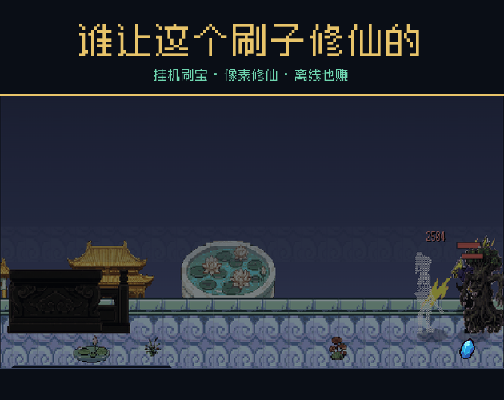
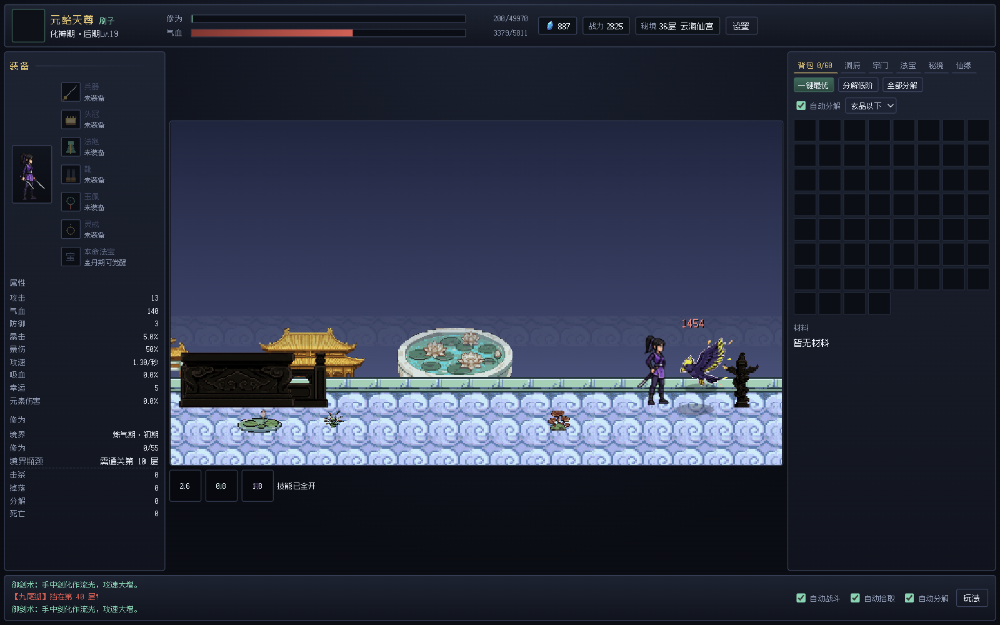
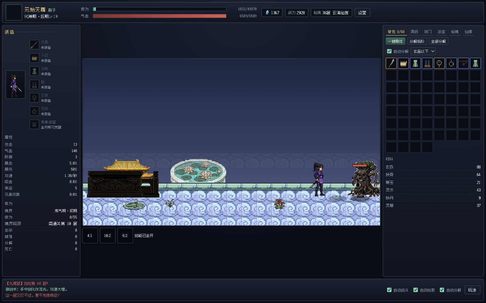

<div align="center">

# 谁让这个刷子修仙的

**挂机刷宝 · 像素修仙 · 离线也赚**

> 别的游戏让你肝，这个游戏让你看着别人肝。



[](https://will-yee.itch.io/)
]
]
]

</div>

---

## 这是什么

一款**修仙题材的挂机刷宝像素游戏**。起个道号，选个出身，然后你的修士自己去秘境砍怪、捡装备、炼丹、渡劫——你只需要看着它越来越强。

**完全免费、无广告、无内购、无后端、无数据上传。**

## 玩法一览

| 系统 | 内容 |
|---|---|
| 创角 | 道号（试试「元始天尊」）、5 种出身、9 种形象 |
| 战斗 | 自动寻怪与连招，17 种妖兽、3 头守关 Boss、6 个秘境章节 |
| 刷宝 | 6 部位 × 6 品质（凡灵玄地天仙）× 12 种词缀，名字全是随机中文 |
| 成长 | 炼气 → 筑基 → 金丹 → 元婴 → 化神 → 炼虚 → 合体 → 大乘 → 渡劫 → 真仙 |
| 渡劫 | 每次大境界要扛一场雷劫，扛不住修为散一半 |
| 技能 | 剑气斩 / 御剑术 / 九霄雷法，随境界自动解锁施放 |
| 洞府 | 丹炉队列（5 种丹方）、图纸打造、强化 +N、洗练词缀、3 块灵田种药 |
| 法宝 | 金丹期觉醒本命法宝，6 种原型、4 阶进化、器灵会说话还有 10 段小故事 |
| 宗门 | 10 位 NPC、好感赠礼、4 条道侣专属任务链、结契与双修 |
| 任务 | 每日任务（可花灵石扫荡）、宗门悬赏、6 种随机事件 |
| 飞升 | 真仙 + 通关 90 层可转生，7 项仙缘天赋永久生效，飞升榜记录历代轮回 |
| 离线 | 最多算 12 小时，60% 效率，上线有结算报告 |

## 截图





更多见 [`itch-assets/screenshots/`](itch-assets/screenshots)

## 怎么玩

### 网页版（推荐，手机也能玩）

直接打开 **[在线试玩](https://akiFinn3.github.io/shuazi-xiuxian/)**（Pages 部署）。

手机浏览器打开后 → 菜单「添加到主屏幕」，即可全屏当 App 玩，**断网也能开**。

**移动端是专门适配过的**：

- **横屏**：战场铺满全屏，HUD 浮在顶部，底部页签栏在拇指区；点页签从右侧滑出抽屉，再点收起 → 全屏刷
- **竖屏**：战场在上（16:9 不裁切），页签内容在下方可滚动，底部 7 个页签固定
- 点装备弹出**底部详情层**（词缀 + 与身上那件的对比 + 装备/分解），不用 hover
- 触控目标 ≥44px，刘海与手势条做了安全区避让
- 移动端自动降级：关震屏、粒子减半、飘字上限降低

本地跑：

```bash
./run.sh          # 默认 8123 端口
python3 tools/serve.py   # 带 no-cache 的开发服务器（改完刷新即生效）
```

看双机位效果：浏览器打开 `dev/mobile.html`（横屏 852×390 + 竖屏 393×852 并排）。

### Windows

下载 `谁让这个刷子修仙的-v1.0.0-Windows.zip`，解压后双击 **`Start Game.bat`**。
会自动用系统自带的 PowerShell 起一个只监听本机的服务并打开浏览器，**不需要安装任何运行时**。

### macOS

下载 `谁让这个刷子修仙的-v1.0.0-macOS.zip`，解压后双击 **`刷子修仙.app`**。
原生窗口、无地址栏、离线可玩。

> 首次打开若提示「无法验证开发者」，请 **右键 → 打开 → 打开**（未购买 Apple 开发者证书，无法公证）。

### 换设备 / 备份

存档在浏览器本地，**不联网、不同步**。
游戏内「设置 → 导出存档」复制存档码，在新设备「导入存档」即可整体搬家（境界、装备、仙缘、道侣全带走）。

## 开发者

```bash
python3 tools/build_assets.py     # 加工素材 → assets/game + js/data/sprites.js
python3 tools/build_dist.py        # 打包网页版 → dist/
python3 tools/build_macos_app.sh   # 构建 macOS .app（需 Xcode Command Line Tools）
python3 tools/build_platforms.py   # 汇总三个端的发布文件夹与 zip
python3 tools/build_release.py    # 一键出全部发布物
```

- 纯静态：HTML + ES Modules + Canvas 2D，**零构建、零依赖**
- 固定 60Hz 逻辑步长 + rAF 渲染
- 资源全部本地化，可离线运行

## 授权与署名

- 美术：[Xianxia Pixel Pack](https://willyee.itch.io/xianxia-pixel-pack) by **willYEE** — **CC0 1.0**（公共领域，可商用可修改）
- 字体：[Fusion Pixel](https://github.com/TakWolf/fusion-pixel-font) by **TakWolf** — **SIL OFL 1.1**；[Zpix](https://github.com/SolidZORO/zpix-pixel-font)
- 音效：WebAudio 实时合成，未用第三方音频
- 界面图标：本项目脚本自绘（`tools/make_icons.py`）
- 代码 / 数值 / 文案：原创

完整署名见 [`署名与授权.txt`](署名与授权.txt) 与 [`LICENSES.md`](LICENSES.md)。

## 内容提示

含成人向情感暗示（不露骨），建议 18 岁以上游玩。

---

<div align="center">
制作：渝州秋 (AkiFinn3) · 愿你的道友，氪得其所。
</div>
